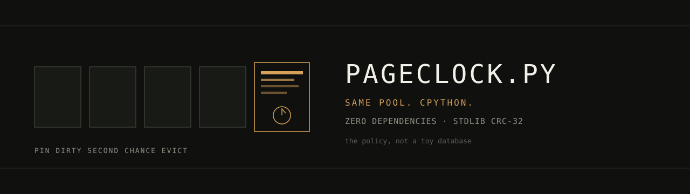

<p align="center">
  
</p>

# pageclock.py

Clock-sweep buffer pool. Pure Python. Zero third-party dependencies.

This is the same policy as [pageclock](https://github.com/vantacorehq/pageclock), the Rust crate: which page stays, which one is dirty, and which frame the clock is allowed to take. It is not a teaching rewrite and it is not a database. CPython is the wrong place for the hot path. It is the right place to drive the policy against a fake disk and a fixed schedule before the same rules run in Rust.

Postgres shared buffers and the InnoDB buffer pool are this clock with a machine around it. The interesting part fits in one file.

## Contract

* Fixed frames. `page_size >= 8`, `frames >= 1`. No allocation after `Pool(...)` beyond the frame table itself.
* A hit bumps the pin count and sets the reference bit.
* A miss takes a free frame, else walks from the clock hand. Pinned frames are skipped. A referenced unpinned frame loses the bit and survives once.
* `bytes_mut` marks the frame dirty. Eviction calls `flush(page_id, snapshot)` before reuse. The snapshot is `bytes`, not a live view.
* `FlushFailed` leaves the resident page in place, still dirty.
* `LoadFailed` does not evict. A page that was flushed first stays resident and clean.
* `seal` / `verify` use ISO-HDLC CRC-32 (`zlib.crc32`). `crc32(b"123456789") == 0xCBF43926`.
* The directory is a scan of frame headers. There is no second index to desynchronise.
* One thread. `load` and `flush` must not re-enter the pool.

## Usage

```python
from pageclock import Pool

pool = Pool(page_size=4096, frames=64)

def load(buf: bytearray) -> None:
    buf[:8] = (7).to_bytes(8, "little")

def flush(page_id: int, image: bytes) -> None:
    # Called only when a dirty frame is about to be reused.
    del page_id, image

frame = pool.pin(7, load, flush)
pool.bytes_mut(frame)[0] = 0xAB
pool.seal(frame)
pool.verify(frame)
pool.unpin(frame)
```

## Tests

```bash
python -m unittest discover -s tests -v
```

The suite is the Rust suite plus a read-only memoryview check and a 500-step schedule against an in-memory disk (`random.Random(0xC10C)`). Clean frames must match the last durable image. A refused flush must not invent a new resident page.

## License

[MIT](LICENSE)
